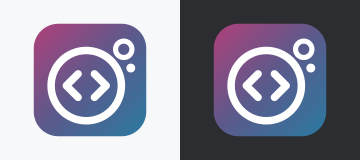
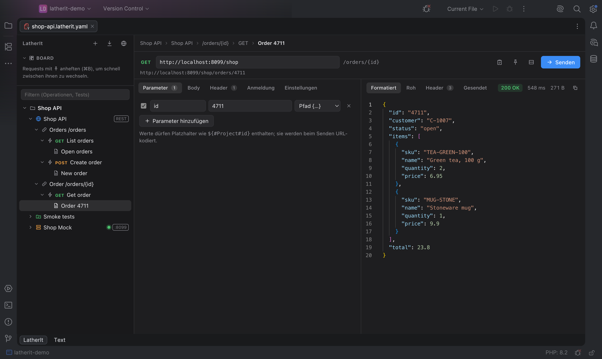

# LatherIt



Plugin ID `app.heckit.ide.latherit` · Vendor heck\it ([heckit.app](https://heckit.app)) · [JetBrains Marketplace](https://plugins.jetbrains.com/plugin/34776-latherit) · Source: https://github.com/phse/latherit-ide-plugin



LatherIt in JetBrains IDEs (PhpStorm, IntelliJ IDEA, WebStorm, …): project files `*.latherit.yaml`
open with a **LatherIt** tab in front of the regular text editor. The UI is the same as in the
LatherIt desktop app.

**Status: prototype.** Tested: opening projects, auto-save, reloading after external changes, HTTP
requests, loading resources, `${#System#…}`/`${#Env#…}`, web workers, light/dark like the IDE, mock
services, authentication with Basic, Bearer, Digest and NTLM (with unit tests). Not tested yet:
dialogs, clipboard, keyboard shortcuts.

Differences from the desktop app:

- **Saving** happens automatically shortly after every change (like other files in the IDE), through
  the IDE's document, so the change also shows up in the text tab, in Git and in Local History.
- If the file is changed **outside** (text tab, Git, another program), the UI reloads.
- **Mock services** belong to the editor tab that started them and end when it is closed.
- **Keyboard shortcuts** taken by the IDE itself are passed on by the plugin: ⌘↵, ⌘S, ⇧⌘S, ⌘I, ⇧⌘N,
  ⌘B, ⇧⌘F, ⌘1, ⌘2.

## Installation

In the IDE, go to *Settings | Plugins | Marketplace* and search for **LatherIt**, or use the
[Marketplace page](https://plugins.jetbrains.com/plugin/34776-latherit). Bugs and ideas are
welcome as [GitHub issues](https://github.com/phse/latherit-ide-plugin/issues).

## Build and run

Requirements: a checkout of LatherIt (default: `../../latherit`, see `latheritDir`), Node/npm for
its build, and JDK 17 or later for Gradle. The toolchain (JDK 25) is downloaded by Gradle via
foojay if needed.

```
./gradlew runIde        # start a sandbox IDE with the plugin
./gradlew buildPlugin   # build/distributions/latherit-ide-plugin-<version>.zip
./gradlew test          # unit tests (authentication, mock server)
```

Verify against the target platform:

```
./gradlew verifyPlugin
```

Options (`-P…`):

- `openProject=/path/to/project` opens a project in the sandbox right away
- `cefDebugPort=9222` makes the sandbox's Chromium DevTools available at `http://localhost:9222`
- `npmCommand=/path/to/npm` if Gradle can't find `npm`

Install a self-built ZIP: *Settings | Plugins | ⚙ | Install Plugin from Disk…*

By default Gradle downloads PhpStorm `platformVersion` (from `gradle.properties`) as the target
platform. With an installed IDE it's faster: create `local.properties` (not checked in) containing
e.g.

```
platformLocalPath=/Applications/PhpStorm.app
latheritDir=/path/to/latherit
```

## Publishing (JetBrains Marketplace)

The Marketplace description lives in `src/main/resources/META-INF/plugin.xml`, the change notes in
`build.gradle.kts`, the icon in `META-INF/pluginIcon.svg` (light theme) and `pluginIcon_dark.svg`
(dark theme). The IDE and the Marketplace read the icon straight from the ZIP, it doesn't have to be
uploaded separately. `marketplace/plugin-icon.png` at the top of this README is a preview of both.

1. Bump the version in `gradle.properties`, add change notes.
2. `./gradlew clean buildPlugin verifyPlugin` (fix any deprecated API it reports before releasing)
3. `PUBLISH_TOKEN=… ./gradlew publishPlugin` with a token from
   https://plugins.jetbrains.com/author/me/tokens, or upload the ZIP from `build/distributions/` by
   hand on the [Marketplace page](https://plugins.jetbrains.com/plugin/34776-latherit). JetBrains
   reviews every version before it is released.
4. Tag the commit (`git tag v<version>`) and push.

Signing is optional (variables `CERTIFICATE_CHAIN`, `PRIVATE_KEY`, `PRIVATE_KEY_PASSWORD`,
see https://plugins.jetbrains.com/docs/intellij/plugin-signing.html).

## Regenerating the screenshots

```
./gradlew runIde -Pscreenshots=marketplace/screenshots
```

Copies `marketplace/demo-project` to `/Users/Shared/latherit-demo` (so no user path shows up in the
images), opens it in the sandbox, starts the mock and writes four PNGs to `marketplace/screenshots/`
(request side by side, stacked, mock with log, test run). The IDE paints its own window, the UI comes
from the Chromium DevTools, so no screen recording permission is needed. The helper lives in
`src/screenshot/` and is only compiled with `-Pscreenshots`, never into a release. Close the sandbox
afterwards.

If the sandbox asks on the first run, confirm "Trust Project" once and run the command again.

## How it works

The UI's source code is not in this repository but in the (private) LatherIt repository: the
Gradle build runs `npm run build` there and packs the result into the plugin under `/latherit-web/`,
where an embedded Chromium (JCEF) shows it. Instead of the desktop app's Rust backend, the plugin
answers the UI's commands, with the same names, parameters and results. Paths like
`src/lib/backend.ts` in comments refer to the LatherIt repository.

| File | Contents |
| --- | --- |
| `LatherItEditorProvider.kt` | Editor tab for `*.latherit.yaml` |
| `LatherItView.kt` | JCEF browser, bridge (`window.__latheritIde`), light/dark, keyboard shortcuts, reloading after external changes |
| `WebResources.kt` | Serves the UI at `https://latherit.ide/` (a real origin for web workers) |
| `HostCommands.kt` | Commands: files (through the IDE's documents), system, dialogs, clipboard |
| `HttpBackend.kt` | HTTP with the proxy from the IDE settings (counterpart of `http.rs`) |
| `ChallengeAuth.kt` | Authentication: Basic, Bearer, Digest, NTLMv2 (counterpart of `auth.rs`) |
| `MockServers.kt` | Mock servers with the JDK's HTTP server (counterpart of `mock.rs`) |
| `SystemTrust.kt` | Certificates like in the browser: root certificates from macOS/Windows, then the IDE's |

## License

The source code of this repository is licensed under the [Apache License 2.0](LICENSE). The
LatherIt UI included at build time as well as the name and logo are excluded, see [NOTICE](NOTICE).
